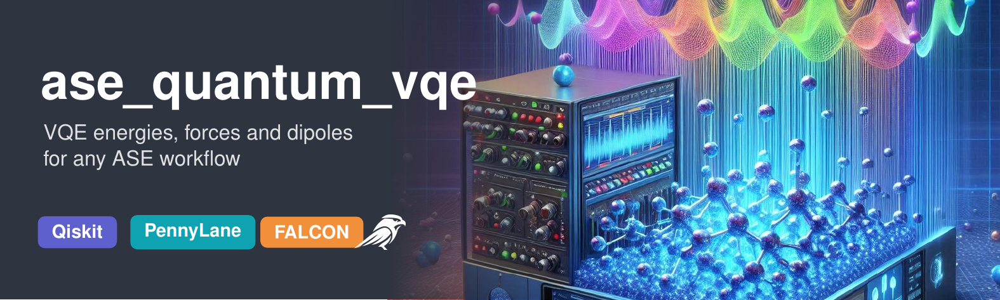

# ase_quantum_vqe — VQE energies, forces, and dipoles in ASE

ASE calculators that make energies, forces, and dipole moments from the variational quantum eigensolver
(ADAPT-VQE) available in the [Atomic Simulation Environment](https://wiki.fysik.dtu.dk/ase/).
Existing ASE scripts for geometry optimization, minima hopping, vibrational and IR analysis, JEDI strain
analysis, and molecular dynamics run on VQE by changing one line.



**Documentation, tutorials and manual: https://thequantumchemist.github.io/ase_quantum_vqe/**

| Calculator | Module | Forces | Execution |
| --- | --- | --- | --- |
| `QiskitVQECalculator` | `ase_quantum_vqe.qiskit_vqe_calculator` | central finite differences (6N+1 VQE solves) | exact statevector, sampled (qiskit-aer), IBM Quantum |
| `PennyLaneAdaptVQECalculator` | `ase_quantum_vqe.pennylane_calculator` | analytic, −⟨ψ\|∂H/∂R\|ψ⟩ (one VQE solve) | exact statevector, finite shots |
| `PySCFCalculator` | `ase_quantum_vqe.utils.pyscf` | finite differences or analytic | classical reference (HF, CCSD, FCI) in the same active space |
| `DistanceGPR` | `ase_quantum_vqe.surrogates` | exact derivative of the surrogate energy | force-trained Gaussian process for FALCON active learning |

The code accompanies the article *Variational Quantum Forces in Atomistic Simulation Workflows: Analytic
Gradients, Measurement Noise, and Force-Controlled Active Learning* (W. Dononelli, submitted to J. Chem. Inf.
Model.; preprint arXiv:2602.02695). All scripts and data for its figures and tables are in [`paper/`](paper/).

---

## Installation

PySCF is most reliable from conda; a fresh environment avoids conflicts with older Qiskit installations
(Qiskit Nature currently requires Qiskit < 2.0).

    conda create -n ase-vqe python=3.12
    conda activate ase-vqe
    conda install -c conda-forge pyscf
    pip install "ase_quantum_vqe[all] @ git+https://github.com/thequantumchemist/ase_quantum_vqe.git"

Or from a clone, with only the parts you need:

    git clone https://github.com/thequantumchemist/ase_quantum_vqe.git
    cd ase_quantum_vqe
    pip install -e .              # Qiskit backend and PySCF reference
    pip install -e ".[pennylane]" # + PennyLane backend (analytic forces)
    pip install -e ".[aer]"       # + finite-shot sampling with qiskit-aer
    pip install -e ".[falcon]"    # + FALCON active learning (pins ASE <= 3.26)
    pip install -e ".[all]"       # everything, including JEDI, matplotlib, pytest

The exact versions used for the paper are listed in `requirements.txt`. Check the installation with

    pytest -q tests

### Known issue with AGOX and NumPy 2

FALCON's default GPR model comes from AGOX. With NumPy 2, AGOX 3.11 stops during hyperparameter training
with `TypeError: only 0-dimensional arrays can be converted to Python scalars`. Until fixed upstream,
change one line in `agox/models/GPR/GPR.py`:

    P, grad_P = -float(P), -np.asarray(grad_P, dtype="float64")            # before
    P, grad_P = -float(np.squeeze(P)), -np.asarray(grad_P, dtype="float64") # after

The `DistanceGPR` surrogate in this package does not depend on AGOX.

---

## Quick start

```python
from ase.build import molecule
from ase.optimize import BFGS
from ase_quantum_vqe.qiskit_vqe_calculator import QiskitVQECalculator
# from ase_quantum_vqe.pennylane_calculator import PennyLaneAdaptVQECalculator

atoms = molecule("H2")
atoms.calc = QiskitVQECalculator(basis="sto3g")              # exact statevector simulator
# atoms.calc = PennyLaneAdaptVQECalculator(basis="sto-3g")   # analytic forces
BFGS(atoms).run(fmax=0.005)
print(atoms.get_potential_energy(), atoms.get_forces())
```

### Qiskit backend options

| `backend=` | Meaning |
| --- | --- |
| `'statevector'` (default) | exact expectation values; `shots` is ignored |
| `'aer_shots'` | finite-shot sampling with qiskit-aer (`shots` per measurement setting, optional `seed`) |
| `'aer'` | deprecated alias of `'statevector'`, kept so that old scripts give unchanged results |
| any other name | IBM Quantum backend via Qiskit Runtime (`ibmq_token`, `ibm_channel`, `ibm_instance`, `shots`, `resilience_level`) |

Other keywords: `coreorb` (frozen core orbitals), `delta` and `nfree` (finite-difference step in Å and
2- or 4-point stencil), `n_jobs` (parallel displaced solves), `optimizer_name` (`'SLSQP'`, `'COBYLA'`,
`'L_BFGS_B'`), `maxiter`, `vqe_eigenvalue` (ADAPT energy threshold).

**Hardware execution.** Qiskit Runtime now provides V2 primitives, while `qiskit-algorithms` 0.3 expects
V1 estimators. The calculator wraps the Runtime `EstimatorV2` in a V1 adapter that transpiles circuits to
the backend and maps observables onto the qubit layout (`make_ibm_estimator`). The adapter is tested with
fake IBM backends (`qiskit_ibm_runtime.fake_provider`), not on real hardware. Finite-difference forces are
impractical with shot noise (see the paper); use the hardware path for energies or analytic gradients.

### PennyLane backend options

`coreorb`, `maxiter`, `conv_tol`, `optimizer_name` (`'BFGS'`/`'SLSQP'` for exact simulators,
`'ADAM'`/`'GradientDescent'` with shots), `vqe_eigenvalue` (ADAPT gradient threshold),
`adapt_max_operators`, `use_ADAPT_memory` (reuse the operator list and warm-start the parameters at
the next geometry), `shots`, and, for noise studies, `force_shots` with `seed` (parameters converged
exactly, forces estimated from finite samples). Analytic forces are exact derivatives of the energy only
for converged parameters; the defaults are chosen accordingly.

### Active learning for MD with FALCON

```python
from falcon_md.otf_calculator import FALCON
from falcon_md.utils.langevin import Langevin
from ase_quantum_vqe.surrogates import DistanceGPR

atoms.calc = FALCON(model=DistanceGPR(use_forces=True), calc=vqe_calc,
                    training_data=initial_frames, train_start=2, train_log=False,
                    accuracy_e=0.05, accuracy_f=0.1)
```

A surrogate trained on energies and selected by energy uncertainty alone can predict accurate energies but
very wrong forces, which heats the system; train on forces and set a force threshold (`accuracy_f`).
`DistanceGPR` uses interatomic distances as features and suits small molecules with a fixed atom order.

---

## Changes in version 1.1.0

* New PennyLane backend with analytic forces; ADAPT-VQE now re-optimizes all parameters after each added
  operator and converges them with BFGS (the 1.0 version selected the same operator repeatedly and stopped
  after five gradient-descent steps).
* Qiskit backend: `backend='statevector'` (exact, default) and `backend='aer_shots'` (real sampling);
  `'aer'` was always exact and is now a deprecated alias. Fixed the sign of forces with `nfree=4`.
  Runtime path updated to the current Qiskit Runtime (channels, V2 primitives via an adapter).
* `PySCFCalculator`: `method='fci'` counted the nuclear repulsion twice and ignored `coreorb`; it now uses
  CASCI with all non-core orbitals active. Open shells use ROHF. Optional analytic forces (`forces='analytic'`).
* New `DistanceGPR` surrogate for FALCON with force training and force uncertainty.
* Scripts and data for every figure and table of the paper in `paper/`; tests in `tests/`.
* Documentation site with seven tutorials (`docs/`, `tutorials/`), built with Zensical and deployed to GitHub Pages.

## Citation

See `CITATION.cff`. Please cite the article and the software release (Zenodo DOI in `CITATION.cff`).

## License

GPL-3.0, see `LICENSE`.
