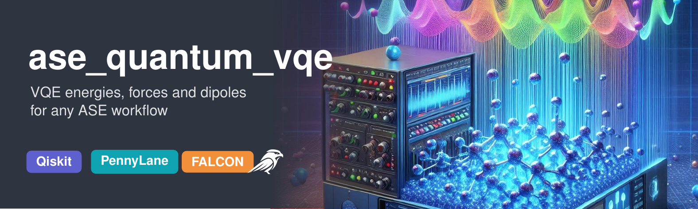
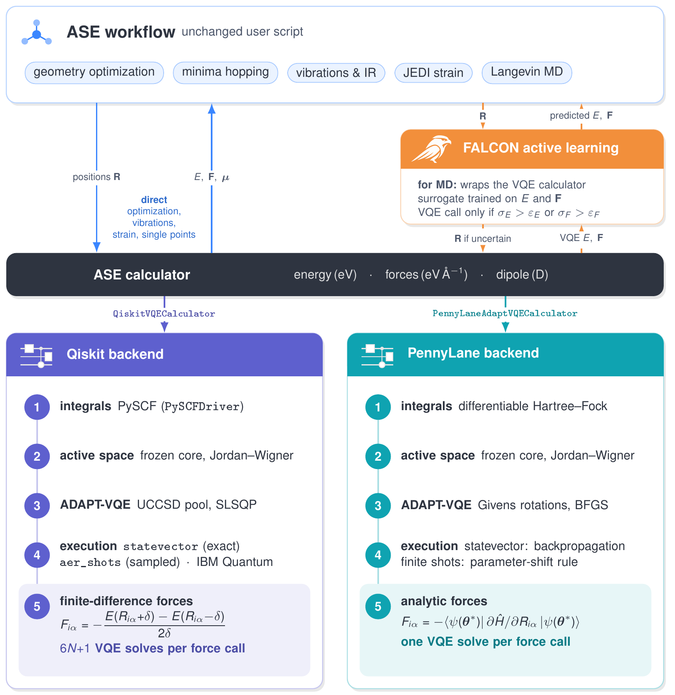

# ase_quantum_vqe

`ase_quantum_vqe` makes energies, forces and dipole moments from the variational quantum eigensolver
(ADAPT-VQE) available in the [Atomic Simulation Environment](https://wiki.fysik.dtu.dk/ase/) (ASE).
Geometry optimization, minima hopping, vibrational and IR analysis, JEDI strain analysis and molecular
dynamics run on VQE by changing one line of an ASE script. Two interchangeable backends are provided:
Qiskit with finite-difference forces, which also runs on IBM Quantum hardware, and PennyLane with
analytic forces. For molecular dynamics, the calculators plug into the on-the-fly active-learning
scheme [FALCON](https://github.com/thequantumchemist/falcon).

-   :material-clock-fast:{ .lg .middle } __Set up in 5 minutes__

    ---

    Install `ase_quantum_vqe` with `pip` and run your first VQE geometry optimization

    [:octicons-arrow-right-24: Installation](install.md)

-   :lucide-gift:{ .lg .middle } __Example__

    ---

    A complete optimization and frequency calculation in a dozen lines

    [:octicons-arrow-right-24: Example](mini_example.md)

-   :octicons-mortar-board-24:{ .lg .middle } __Tutorials__

    ---

    From the first calculation to analytic forces, shot noise and active-learning MD

    [:octicons-arrow-right-24: Tutorials](tutorials/index.md)

-   :lucide-shield-question-mark:{ .lg .middle } __Manual__

    ---

    Every calculator, option and default value

    [:octicons-arrow-right-24: Manual](manual.md)

## Architecture

## Features

* Drop-in ASE calculators for energies, forces and dipole moments from ADAPT-VQE
* Frozen-core active spaces, Jordan–Wigner mapping, Hartree–Fock reference
* **Qiskit backend**: forces by central finite differences (2- or 4-point), parallel displaced solves,
  exact (`statevector`) or sampled (`aer_shots`) simulation, IBM Quantum hardware via Qiskit Runtime
* **PennyLane backend**: analytic forces through a differentiable Hartree–Fock Hamiltonian, one VQE solve
  per force call, finite-shot force estimates for noise studies
* **Classical references** (HF, CCSD, FCI) with PySCF in exactly the same basis and active space
* **Force-trained surrogate** (`DistanceGPR`) for FALCON with energy and force uncertainties
* Scripts and data for every figure and table of the accompanying paper

## Citation

If you use `ase_quantum_vqe`, please cite the article and the software release:

W. Dononelli, *Variational Quantum Forces in Atomistic Simulation Workflows: Analytic Gradients,
Measurement Noise, and Force-Controlled Active Learning*, submitted to J. Chem. Inf. Model.
(preprint [arXiv:2602.02695](https://arxiv.org/abs/2602.02695)).

The software DOI is listed in `CITATION.cff` in the repository.
