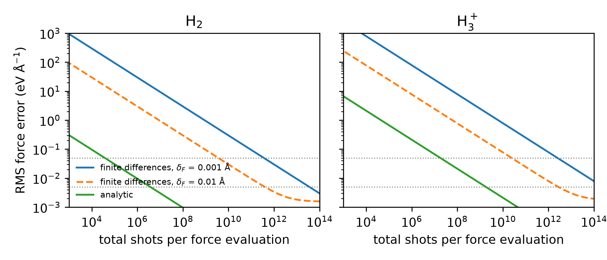

# 4. Forces under finite sampling

On quantum hardware, expectation values are estimated from a finite number of measurements (shots).
This tutorial shows what sampling does to VQE energies and forces.

This tutorial demonstrates:

- Sampled energies with `backend="aer_shots"` (Qiskit)
- Sampled analytic forces with `force_shots` (PennyLane)
- Why the variational optimization itself struggles under noise

```bash
python 04_shot_noise.py
```

## Step 1: Exact versus sampled energies

```python
--8<-- "tutorials/04_shot_noise.py:imports"

--8<-- "tutorials/04_shot_noise.py:energy"
```

```text
exact energy -30.8617 eV; sampled (10^4 shots, full VQE under noise): -30.2265 +- 0.0126 eV
```

With sampling, the whole ADAPT-VQE runs under noise. Its parameter gradients and operator selection
fall below the noise level, and the energy stays close to the Hartree–Fock value. Noise-robust
optimizers are needed for this case.

## Step 2: Sampled analytic forces

```python
--8<-- "tutorials/04_shot_noise.py:forces"
```

```text
   1000 shots: F_z = -2.456 +- 0.207 eV/A   (exact -2.466)
  10000 shots: F_z = -2.462 +- 0.117 eV/A   (exact -2.466)
 100000 shots: F_z = -2.474 +- 0.016 eV/A   (exact -2.466)
```

With `force_shots`, the parameters are converged exactly and only the force estimator is sampled. The
estimate is unbiased and its spread shrinks roughly with the inverse square root of the number of shots
(ten samples per row, so the spreads are themselves uncertain). Finite-difference forces divide the noise
of two energies by the step 2δ; for the same accuracy they need several orders of magnitude more shots
(see Figure 2 of the paper).


