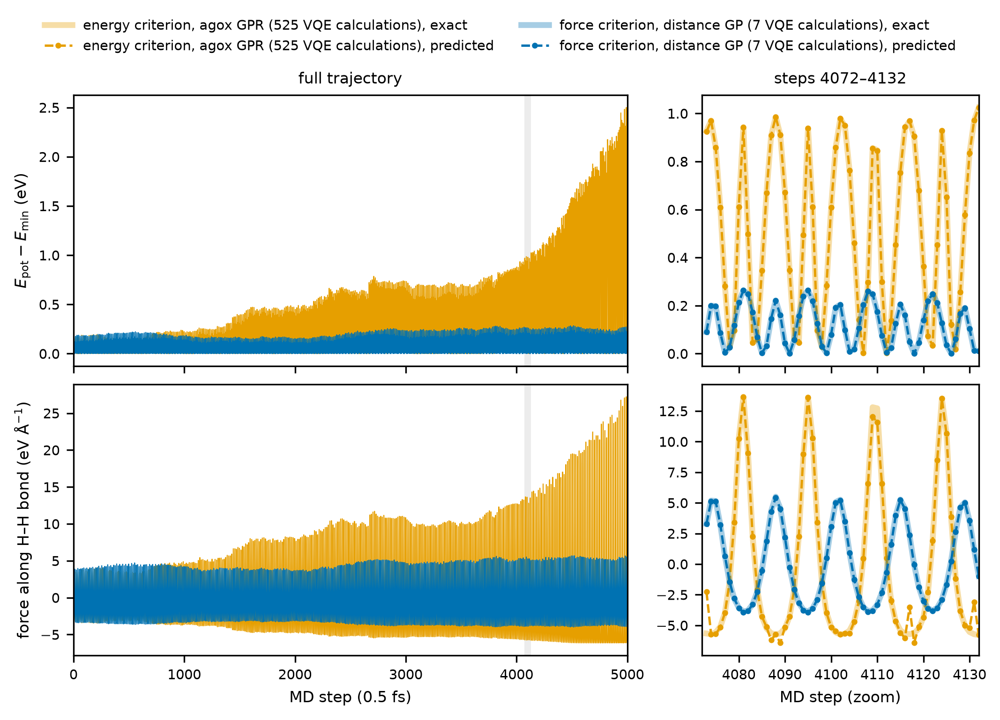

# 5. Molecular dynamics with active learning

Even with analytic forces, a VQE solve at every MD step is expensive. FALCON replaces most force calls
by a surrogate model and calls VQE only when the surrogate is uncertain. This tutorial runs 1 ps of H₂
dynamics at 600 K.

This tutorial demonstrates:

- Initial training data from a VQE geometry optimization
- FALCON with the force-trained `DistanceGPR` surrogate
- Energy and force uncertainty thresholds

```bash
python 05_active_learning_md.py
```

## Step 1: Initial structure and training data

```python
--8<-- "tutorials/05_active_learning_md.py:imports"

--8<-- "tutorials/05_active_learning_md.py:setup"
```

## Step 2: The active-learning calculator

```python
--8<-- "tutorials/05_active_learning_md.py:falcon"
```

`DistanceGPR` is a Gaussian process on the interatomic distances, trained on energies **and** forces. Its
predicted forces are exact derivatives of its predicted energy, and it reports an uncertainty for both.

!!! warning "Control the forces, not only the energies"
    A surrogate trained on energies and selected by energy uncertainty alone can predict energies to
    within meV but forces with errors of several eV/Å. These errors pump energy into the system and drive
    it into unphysical configurations (Figure 4 of the paper). Always set `accuracy_f`.

## Step 3: Run the dynamics

```python
--8<-- "tutorials/05_active_learning_md.py:run"
```

```text
1 ps of MD: H-H distance 0.751 +- 0.055 A; training set: 9 VQE calculations in total
```

Nine VQE calculations, including those of the geometry optimization, cover 2000 MD steps. In the paper,
10 ps trajectories with this setting needed five to nine VQE calculations and reproduced exact-force
dynamics.



`DistanceGPR` suits small molecules with a fixed atom order: its features are not permutation invariant
and their number grows quadratically with the number of atoms.
